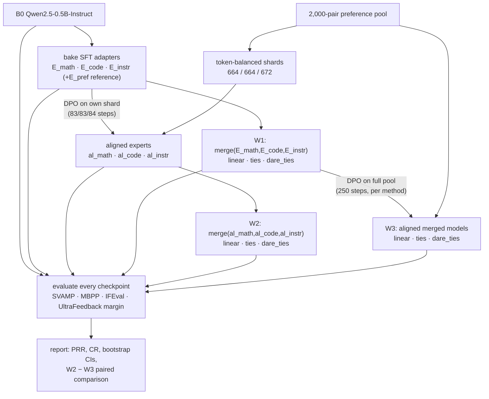

# E4 - Order of Operations: DPO→Merge vs Merge→DPO at an Equal DPO Budget

Part of *Does Preference Alignment Survive the Merge?* (CS769).
This document covers **Experiment 4 only**: what is compared, how the budget is matched, how the
code is organised, how to run it on Kaggle, and how every number is defined.

> **Status:** code written and syntax/unit-checked (shard balancing, bootstrap maths). The GPU paths
> (training, merging, evaluation) have **not been executed yet**; run the 3-step smoke test
> (`bench` job) first on Kaggle.

---

## 1. Question

If preference alignment (DPO) is applied with the *same preference data, tokens and optimizer
steps*, is it better to

* **W2 - align first, then merge:** DPO each SFT expert, then merge the aligned experts, or
* **W3 - merge first, then align:** merge the SFT experts, then DPO the merged model?

W1 (SFT experts merged, no DPO) is the unaligned reference.

## 2. Setup (identical to the rest of the project)

| Item | Value |
|---|---|
| Base model / tokenizer `B0` | `Qwen/Qwen2.5-0.5B-Instruct`, native ChatML template |
| SFT experts | `E_math`, `E_code`, `E_instr` (LoRA r=16, α=32, baked into bf16 checkpoints) |
| Preference pool | `outputs/datasets/e_pref_train.jsonl` - 2,000 UltraFeedback pairs (same pool as `E_pref`) |
| Preference test | `outputs/datasets/e_pref_test.jsonl` - 500 held-out pairs |
| DPO hyper-parameters | `configs/dpo_config.yaml`: β=0.1, lr 5e-5, cosine, warmup 5%, 1 epoch, batch 1 × grad-accum 8, wd 0.01, seed 42, LoRA r=16/α=32/dropout 0.05 on 7 projections |
| Evaluation | SVAMP (300, EM), MBPP sanitized test (257, Pass@1), IFEval (300, strict prompt-level), UltraFeedback margin (500 pairs); greedy decoding, same scripts/settings as E1/E2 |

### Merge algorithms and coefficients

Linear Task Arithmetic, TIES and DARE-TIES, **equal weights 1/3 each** (no `α_pref`: the preference
signal now lives *inside* each expert (W2) or is added afterwards (W3)). SLERP is dropped because it
is defined for two models only.

| Method | Convention (generalised from `src/merge/run_e2_sweep.py` from 2 to N=3 experts) |
|---|---|
| Linear | `θ = θ_B0 + Σ wᵢ τᵢ` |
| TIES | per-tensor top-20% magnitude trim of each `τᵢ`; sign elected from `Σ wᵢ τᵢ_trim`; `τ = Σ wᵢ τᵢ_trim · [sign agrees]` (no divide-by-count; weights sum to 1) |
| DARE-TIES | Bernoulli drop 0.5 with `1/(1-0.5)` rescale (generator seed **10**, as in E2), then TIES as above |
| Excluded tensors | embeddings / `lm_head` / non-float tensors stay at `B0` (as in E2) |

Provenance notes (confirmed with the E2 author):

* `src/merge/merge_methods.py` is **legacy** (its two-model TIES ignores the preference weight).
  **`run_e2_sweep.py` is the source of truth** for E2 and for E4's merge conventions.
* In E2, the end points α=0 and α=1 were returned as the **unmerged** `E_math` / `E_pref`
  (DARE/TIES were not applied there). That is why `ties_1.0` equals `E_pref` exactly. E4 has no end points.
* **One deliberate deviation from E2:** E4 merges in **fp32 and rounds to bf16 once**, whereas E2
  scaled bf16 task vectors. The algorithm is unchanged; with 1/3-scaled deltas this avoids losing small
  updates to bf16 rounding.

## 3. Budget matching

The 2,000-pair pool is the *total* DPO budget for both workflows.

| | Pipeline | DPO runs | Pairs | Optimizer steps | Tokens |
|---|---|---|---|---|---|
| W2 | SFT expert → DPO → merge | 3 × 1 epoch, one per expert, **disjoint token-balanced shards 664 / 664 / 672** | 2,000 | 83 + 83 + 84 = **250** | Σ over shards = total |
| W3 | merge → DPO | 1 × 1 epoch on the **whole pool** (per merge method) | 2,000 | **250** | = total |

* Shard sizes are multiples of 8 (the grad-accumulation size), so **no partial batch is dropped** and
  steps match exactly (250 = 250).
* The split is random (seed 42), then pair swaps are hill-climbed so every shard has the same tokens per
  pair (equal tokens per optimizer step). Token = chosen and rejected sequences (prompt + completion, truncated to 1,024).
* Because W2 and W3 see the **same 2,000 pairs once**, total DPO tokens are identical.
* Why not 2,000 pairs per expert? That is 6,000 pair-passes / 750 steps for W2 vs 250 for W3, i.e.
  not an equal-budget comparison, and 3× the compute on Kaggle.
* Each DPO run's **reference model is its own starting checkpoint** (SFT expert for W2, merged model for W3);
  reference log-probs are recomputed per start model. (Evaluation margins always use B0 as reference.)

## 4. Architecture



Everything is a **resumable job** (marker file `outputs/e4/done/<job>.json`); jobs run as separate
processes pinned to one GPU each (2 in parallel on Kaggle T4×2).

### Job list (`python src/e4/e4_pipeline.py list`)

| Job | What it does |
|---|---|
| `shards` | token-balanced split of the pool into 3 disjoint shards + `shards_info.json` |
| `bake_sft_{math,code,instr,pref}` | bake LoRA adapters into bf16 checkpoints (skipped if checkpoint exists) |
| `b0_ref500` | B0 reference log-probs on the 500 test pairs; compares with the E2 200-pair cache |
| `merge_w1_{linear,ties,dare_ties}` | merge the 3 SFT experts |
| `dpo_exp_{math,code,instr}` | ref log-probs from the SFT expert → DPO on its shard → bake → `al_<k>` |
| `dpo_w3_{linear,ties,dare_ties}` | ref log-probs from `w1_<m>` → DPO on the full pool → bake → `w3_<m>` |
| `merge_w2_{linear,ties,dare_ties}` | merge the 3 aligned experts |
| `eval_<tag>` | all four benchmarks for one checkpoint (tags: `b0`, `e_math`, `e_code`, `e_instr`, `e_pref`, `al_*`, `w1_*`, `w2_*`, `w3_*`) |
| `report` | assemble Table E4 (+ JSON), PRR/CR, bootstrap CIs, W2−W3 comparison |
| `bench` | 3-step DPO timing / memory smoke test (nothing is kept) |
| `pack` | zip all small artefacts into `e4_artifacts.zip` |

DPO training is `train_dpo()` in `e4_pipeline.py`: the **same loop, optimiser, schedule and loss as
`src/train/train_dpo_stable.py`** (it imports its `compute_logp_for_completion`), except that the starting
model is a parameter and pairs / steps / tokens / runtime / peak memory are logged. Data order is not
shuffled, as in the E_pref run.

## 5. Metric definitions

Let `margin(M) = mean over test pairs of β·[(log π_M(y_c) − log π_M(y_r)) − (log π_B0(y_c) − log π_B0(y_r))]`, β = 0.1.
By construction `margin(B0) = 0`, so **Δ vs base = margin(M)**.

* **Preference score:** `margin` on the 500 test pairs (headline), also the first-200 subset (comparable to E2,
  where `E_pref` = +0.31489) and the raw token-normalised log-likelihood win rate.
* **PRR (headline)** `= margin(M) / margin(parent)`, where `parent` is the **pair-wise mean of the three
  aligned experts' margins** (`al_math`, `al_code`, `al_instr`). The same denominator is used for W2 and W3 so
  they are directly comparable. With a 95 % paired bootstrap CI over test pairs. Not clipped; values > 100 % are possible.
* **PRR variants:** with each aligned expert as parent separately, and with `E_pref` (2,000 pairs on B0) as parent.
* **CR_bench** `= (S(M) − S(B0)) / (S(E_k) − S(B0))` with `E_k` the SFT specialist of that domain
  (math→SVAMP, code→MBPP, instr→IFEval prompt-level). All scores, including anchors, are **re-evaluated on
  the Kaggle GPU** so denominators are hardware-consistent.
* **W2 − W3** paired difference (95 % paired-bootstrap CI over items) for preference margin, SVAMP, MBPP, IFEval.
* **DPO accounting:** pairs, optimizer steps, tokens, training seconds (W2 = sum over the three runs), and merge seconds.

> Caution: the SFT experts start with a *negative* margin vs B0 (in E2, `E_math` ≈ −0.139), so the aligned
> experts' margins over B0 may be small. If the PRR denominator is small, PRR is noisy; read it together with
> the raw margins and CIs. SVAMP / IFEval with n=300 carry about ±3 pt noise, comparable to the specialist gains
> (+5 to +8 pt), so CR is noisy too.

## 6. Files added for E4

```text
CS769/
├── src/e4/e4_pipeline.py        # all jobs + CLI (shards, bake, merge, DPO, eval, report, pack)
├── run_e4_kaggle.ipynb          # Kaggle driver (T4 x2): smoke test → stages → report → zip
└── README_E4.md                 # this file
```

Produced at run time (`outputs/e4/`):

```text
outputs/e4/
├── data/            shard_{math,code,instr}.jsonl, shards_info.json, *_with_ref.jsonl (temporary)
├── adapters/        DPO LoRA adapters: al_{math,code,instr}, w3_{linear,ties,dare_ties}
├── train_metrics/   per-DPO-job pairs, steps, tokens, seconds, s/step, peak GB, GPU, training log
├── results/         eval_<tag>.json (per-item correctness + per-pair margins), table_e4.md/.json
├── done/            resumability markers
├── logs/            one log per job
└── b0_pref_500_cache.json
outputs/checkpoints/e4/   al_*, w1_*, w2_*, w3_*  (deleted after eval when --delete_after and no longer needed)
```

## 7. Running on Kaggle

1. Create a Kaggle Dataset with the repo root containing `configs/`, `src/` (incl. `src/e4/`, `src/eval/*`,
   `src/train/train_dpo_stable.py`, `src/data/precompute_ref_logps.py`), `outputs/adapters/{e_math,e_code,e_instr,e_pref}`,
   `outputs/datasets/{e_pref_train,e_pref_test}.jsonl` and (optional) `outputs/results/b0_pref_200_cache.json`.
2. New notebook → upload `run_e4_kaggle.ipynb`; set **Accelerator: GPU T4 ×2**, **Internet: On**.
3. Edit `DATASET_DIR` in cell 3, then run top to bottom. **Run the smoke-test cell before Stage 1**: it prints
   seconds/step and a GPU-hour estimate for the 1,000 DPO steps.
4. Sessions are limited (≈12 h) and files are lost afterwards: **download `e4_artifacts.zip`** after each stage
   (`pack` job). Re-running the same cells resumes from the markers. An interrupted DPO job restarts from scratch
   (≤ 250 steps).
5. Same code runs on any CUDA machine: `python src/e4/e4_pipeline.py run --job <id>` (`status` shows progress).

Rough cost (unverified; the smoke test gives the real number): about 1,000 DPO steps (250 for W2 + 3 × 250 for W3)
and 16 evaluations (≈ 12–15 min each on a T4). Disk: ~1 GB per checkpoint, ≈ 20 GB limit.

## 8. Known limitations

* bf16 on a T4 is emulated (slower than on Ampere); numerics differ slightly from the original training GPU,
  hence all anchors are re-evaluated.
* Single seed (42, DARE seed 10). Multi-seed runs belong to the robustness experiment.
* DPO deltas are baked into bf16 weights (as for `E_pref`), so rounding is part of every measured number.
* The aligned-parent PRR denominator can be small (see §5).
* MBPP execution uses a 3 s subprocess timeout; heavy CPU contention while two jobs share a machine could cause
  spurious timeouts (same code as E1).

## 9. Results (fill after the run)

Generated automatically in `outputs/e4/results/table_e4.md`.

| Model | Pref margin (500) | PRR [95 % CI] | SVAMP | MBPP | IFEval | CR_math / code / instr | DPO pairs | steps | tokens | train s |
|---|---|---|---|---|---|---|---|---|---|---|
| W1 linear / ties / dare_ties | | | | | | | 0 | 0 | 0 | 0 |
| W2 linear / ties / dare_ties | | | | | | | 2,000 | 250 | | |
| W3 linear / ties / dare_ties | | | | | | | 2,000 | 250 | | |
