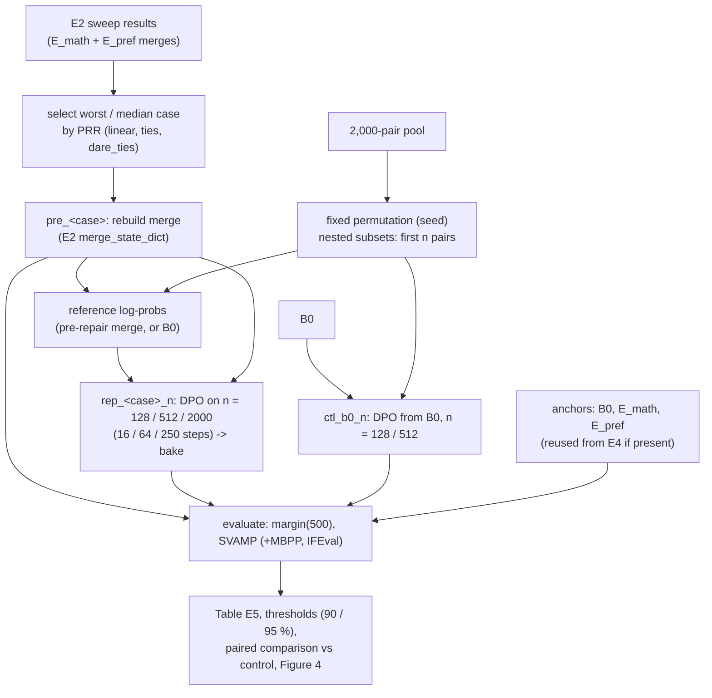

# E5 - Post-Merge Repair Budget: How Many Preference Pairs Fix a Degraded Merge?

Part of *Does Preference Alignment Survive the Merge?* (CS769).
This document covers **Experiment 5 only**: the question, the protocol, how the code is organised, how to run it on
Kaggle, and how every number is defined. It reuses the building blocks of E4 (`src/e4/e4_pipeline.py`) and E2
(`src/merge/run_e2_sweep.py`); read `README_E4.md` for the shared DPO / evaluation setup.

> **Status:** code written and checked for syntax; case selection was run on the real E2 results, and the report /
> Figure 4 code was exercised on **synthetic** data. The GPU paths (merge rebuild, DPO, evaluation) have **not been
> executed yet**.

---

## 1. Question

After a merge has damaged preference alignment, how many preference examples does a *post-merge* DPO "repair" need to
recover 90 % / 95 % of the aligned parent's preference gain (plan §1 goal, RQ6, Fig. 4)? And is a merged model easier to
repair than the base model is to align from scratch?

## 2. Protocol

| Element | Choice |
|---|---|
| Parent (PRR denominator) | `E_pref`: DPO on B0 with all 2,000 pairs |
| Merges to repair | The **worst** and the **median** PRR cases of the E2 two-model sweep (E_math + E_pref) among Linear / TIES / DARE-TIES at 0 < α < 1 (27 candidates). Picked automatically from `outputs/results/e2_sweep_results.json`; on the current E2 data: **`linear_0.1`** (PRR −26.4 %, preference reversed, CR_math +162 %) and **`linear_0.5`** (PRR +29.8 %, CR_math +81 %). Explicit cases can be set in the config. |
| Merge rebuild | With **E2's own `merge_state_dict`** (bf16 arithmetic, DARE seed 10), so the starting models are the E2 ones. (E4 merges differ: fp32.) |
| Repair budgets | **128 / 512 / 2000** pairs = the plan's 125 / 500 / 2k rounded to multiples of 8 (the gradient-accumulation size), so no partial batch is dropped: 16 / 64 / 250 optimizer steps. Optional finer points (32, 64) or 8000 (needs a larger pool). |
| Data | **Nested** subsets: the first n pairs of one fixed random permutation of the 2,000-pair pool (seed 42). Same pairs for every case and for the control. |
| DPO settings | Identical to E4 / `configs/dpo_config.yaml`: β 0.1, lr 5e-5, cosine, warmup `max(5, 5 %)` steps, batch 1 × accum 8, LoRA r16/α32, seed 42, 1 epoch over the subset |
| DPO reference model | The **immediate pre-DPO checkpoint** (the merged model), as in E4's W3. Ablation: `ref_modes: ["pre_dpo", "b0"]` also runs repair with B0 as the reference. |
| Control | DPO **from B0** with the same 128 and 512 pairs (2000 = `E_pref` itself). Shows whether a merged model is easier to repair than B0 is to align. |
| Evaluation | UltraFeedback margin on the 500 held-out pairs (B0-relative) + SVAMP 300; optional MBPP 257 + IFEval 300 (`full_eval`). Greedy decoding, same scripts as E4. |
| Seeds | Single seed (42) by default; `seed` in the config runs more (separate markers, adapters, checkpoints). |

## 3. Architecture



Each step is a resumable **job** (marker in `outputs/e5/done[_s<seed>]/`), run in its own process pinned to one GPU
(two in parallel on Kaggle T4×2).

### Jobs and stages (`python src/e5/e5_pipeline.py list --stage <stage>`)

| Stage | Jobs | What they do |
|---|---|---|
| `setup` | `select_cases`, `pool`, `bake_math`, `bake_pref`, `b0_ref500` | pick the two merges; permute the pool and count tokens per budget; bake E_math / E_pref adapters; B0 reference cache on the 500 test pairs (skipped if E4's cache exists) |
| `anchors` | `eval_b0`, `eval_e_math`, `eval_e_pref` | copied from `outputs/e4/results/` when present (and the B0 cache exists), otherwise evaluated |
| `merge` | `merge_<case>` | rebuild the E2 merge → `outputs/checkpoints/e5/pre_<case>` |
| `ref` | `ref_b0`, `ref_<case>` | reference log-probs for the first `max(budgets)` permuted pairs (computed once, sliced for smaller budgets) |
| `repair` | `rep_<case>_<n>_<refmode>`, `ctl_b0_<n>` | DPO on the first n pairs → bake → checkpoint; per-run metrics (pairs, steps, tokens, seconds, s/step, peak GB, GPU) |
| `eval` | `eval_pre_<case>`, `eval_rep_*`, `eval_ctl_*` | benchmarks per checkpoint; `--delete_after` removes checkpoints once nothing needs them |
| `report` | `report`, `pack` | `table_e5.md/json`, `figure4_repair_curve.png`, `e5_artifacts.zip` |

DPO training and baking are E4's `train_dpo()` / `bake()` (same loop, optimiser and schedule as
`src/train/train_dpo_stable.py`).

## 4. Metrics

Let `margin(M)` be the B0-relative DPO margin on the 500 test pairs (β = 0.1; B0 = 0 by construction).

* **PRR after repair** `= margin(M) / margin(E_pref)`, unclipped, with a 95 % paired bootstrap CI over test pairs
  (so PRR > 100 % is possible). `margin(E_pref)` is the re-measured parent (≈ +0.276 in E4).
* **Lost gain recovered** `= (PRR_after − PRR_pre) / (1 − PRR_pre)`, i.e. the share of the gap to the parent that the
  repair closes (reported for each budget; reported as "-" if undefined).
* **Smallest budget reaching a target** (90 %, 95 %), three ways: by **point estimate**, by the **95 % CI lower bound**
  (conservative), and by **log-linear interpolation** of the point estimates between neighbouring budgets (an estimate,
  not a measurement). "≤ n" means the smallest tested budget already reaches the target.
* **Repaired merge vs control:** paired bootstrap difference in margin and SVAMP at equal budget (repair − DPO from B0).
* **Capability:** SVAMP and `CR_math = (S(M) − S(B0)) / (S(E_math) − S(B0))`; with `full_eval` also MBPP and IFEval raw
  scores (CR for code / instruction following is not defined here, since E_code / E_instr are not part of these merges).
* **Budget accounting:** pairs, steps, tokens, DPO training seconds per run (`outputs/e5/train_metrics/`).

## 5. Files

```text
CS769/
├── src/e5/e5_pipeline.py     # all jobs + CLI (imports src/e4/e4_pipeline.py and src/merge/run_e2_sweep.py)
├── run_e5_kaggle.ipynb       # Kaggle driver: config → stages → report → zip → GitHub push
└── README_E5.md              # this file
```

Produced at run time:

```text
outputs/e5/
├── config.json, cases.json            # configuration used, selected cases (+ their E2 PRR / CR)
├── data/                              # pool_perm.jsonl, pool_info.json, ref_*.jsonl (temporary), subsets/ (temporary)
├── adapters/                          # repair LoRA adapters (rep_*, ctl_*), ~35 MB each
├── train_metrics/                     # one JSON per DPO run
├── results/                           # eval_<tag>.json (per-item correctness, per-pair margins), table_e5.md/.json, figure4_repair_curve.png
├── done[_s<seed>]/  logs/             # resumability markers, per-job logs
outputs/checkpoints/e5/                # pre_*, rep_*, ctl_* (deleted after eval when --delete_after)
```

## 6. Running on Kaggle

1. Repo in the working directory (`/kaggle/working/LLM_Merging`) with `src/e4/`, `src/e5/`, `src/merge/run_e2_sweep.py`,
   `outputs/results/e2_sweep_results.json`, the E_math / E_pref adapters and both preference JSONLs. If you have the E4
   outputs (`outputs/e4/results/eval_{b0,e_math,e_pref}.json` and `outputs/e4/b0_pref_500_cache.json`) the anchors are reused.
2. Upload `run_e5_kaggle.ipynb`; **GPU T4 ×2**, **Internet On**, secret `GITHUB_TOKEN` attached (last cell only).
3. Edit the **config cell** if needed (budgets, cases, `ref_modes`, `controls`, `full_eval`, `seed`), then run top to bottom.
4. `pip uninstall -y torchao` (already in cell 3) avoids a PEFT/torchao version error seen on Kaggle.
5. Re-running resumes from the markers; an interrupted DPO job restarts from scratch (≤ 250 steps).

Rough cost, **estimated** from E4's measured 8.7 s per step on a T4 (not yet measured for E5): 16 + 64 + 250 = 330 DPO steps
per case ≈ 50 min, so about 1.7 GPU-hours for two cases, plus about 12 min for the control; reference log-probs and
bakes add a few minutes per job. About 13 evaluations at roughly 5 min each in the default fast mode (SVAMP + preference);
`full_eval: true` makes evaluations about 3× slower.

## 7. Known limitations

* **Single seed.** CIs reflect test-pair sampling only, not DPO / data-order variance (use the `seed` option for E11).
* **Nested subsets** make the budgets correlated (a larger budget contains the smaller one) - good for a monotone curve,
  but the points are not independent samples.
* **Tiny runs are warmup-dominated.** The shared DPO code uses `max(5, 5 %)` warmup steps, so a 16-step run spends about a
  third of its steps warming up; this may understate what 128 pairs can do. Finer budgets (32, 64) are a config change.
* **8000 pairs** (plan Fig. 4) needs a larger pool than the 2,000-pair file; set `pool_path` and add 8000 to `budgets`.
* **Selection of the cases** uses E2 PRR (200 pairs, original hardware); pre-repair PRR is re-measured here on 500 pairs,
  so it can differ slightly from the E2 value.
* **Scope:** two-model E_math + E_pref merges only. The E4 consortium (N = 3) merges are not repaired here.
* DPO deltas are baked into bf16 weights, and bf16 on a T4 is emulated; anchors come from the same hardware as E4.

## 8. Results (fill after the run)

Generated in `outputs/e5/results/table_e5.md`.

| Case | Budget | Steps | Pref margin | PRR vs E_pref [95 % CI] | Lost gain recovered | SVAMP | CR_math |
|---|---|---|---|---|---|---|---|
| linear_0.1 (worst) | 0 / 128 / 512 / 2000 | 0 / 16 / 64 / 250 | | | | | |
| linear_0.5 (median) | 0 / 128 / 512 / 2000 | 0 / 16 / 64 / 250 | | | | | |
| control: DPO from B0 | 128 / 512 | 16 / 64 | | | - | | |

Smallest budget reaching 90 % / 95 % of parent PRR: to be filled from the report.
