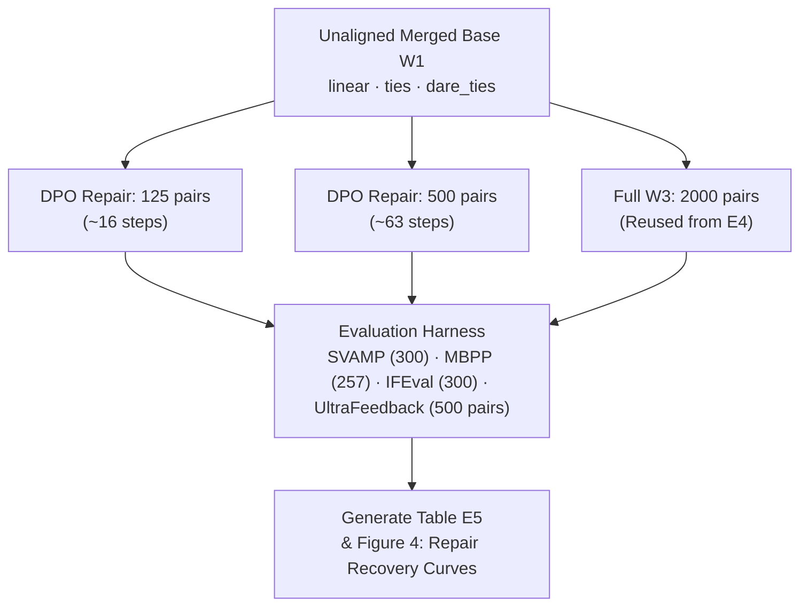

# E5 - Post-Merge Alignment Repair Budget Sweep

Part of *Does Alignment Survive the Merge? Preference Retention and Low-Cost Repair in Small Language Models* (CS769).  
This document covers **Experiment 5 (E5)**: research question, post-merge DPO dosage, resume mechanism, evaluation metrics, and how to execute on Kaggle.

---

## 1. Research Question (RQ6 & Hypothesis H6)

In Experiment 4, we proved that **Merge→DPO ($W_3$) preserves substantially more preference alignment than DPO→Merge ($W_2$)** at equal total training budget (margins $+0.18$ to $+0.20$ vs. $+0.02$ to $+0.04$).  
However, fine-tuning on a full preference dataset ($2,000$ pairs) is compute-intensive.

**E5 asks:**
> *When an unaligned multi-task merge ($W_1$) destroys preference alignment, what is the smallest post-merge DPO repair budget needed to recover 90–95% of the aligned parent's advantage without degrading specialist capabilities?*

---

## 2. Experimental Setup

| Item | Value |
|---|---|
| Base Model ($B_0$) | `Qwen/Qwen2.5-0.5B-Instruct` |
| Specialists | $E_{\text{math}}$ (MetaMathQA), $E_{\text{code}}$ (MBPP/CodeAlpaca), $E_{\text{instr}}$ (SmolTalk) |
| Alignment Anchor | $E_{\text{pref}}$ (UltraFeedback 2,000 pairs, DPO, margin $= +0.2761$) |
| Merges Tested | **Linear Averaging**, **TIES-Merging** (density 0.20), **DARE-TIES** (drop 0.50, density 0.20, seed 10), equal weights $1/3$ |
| DPO Hyperparameters | $\beta=0.1$, learning rate $5\times 10^{-5}$, cosine warmup 5%, batch $1 \times$ grad-accum 8, LoRA $r=16, \alpha=32$ on 7 projection matrices |
| Reference Model | Each repair run uses its own starting checkpoint ($W_1$ unaligned merge) as reference model |
| Hardware Targets | Dual Tesla T4 GPUs (Kaggle), bfloat16 mixed precision |

---

## 3. Repair Budget Regimes

The repair subsets are **nested deterministic shards** drawn from the 2,000-pair training pool (`outputs/datasets/e_pref_train.jsonl`, seed 42):
$$\mathcal{D}_{125} \subset \mathcal{D}_{500} \subset \mathcal{D}_{2000}$$

| Budget ($k$) | Role | Optimizer Steps (accum 8) | GPU Time (T4) | Description |
|---|---|---|---|---|
| **0 pairs** | **$W_1$ Baseline** | 0 | 0 s | Raw unaligned merge (negative margin $-0.09$ to $-0.12$) |
| **125 pairs** | Micro Repair | **16** | ~2 min | Ultra-compact patch ($6.25\%$ of full data) |
| **500 pairs** | Medium Repair | **63** | ~8 min | Small alignment dose ($25.0\%$ of full data) |
| **2,000 pairs** | **$W_3$ Upper Bound** | **250** | ~36 min | Full post-merge DPO (reuses E4 results directly) |

Total new training across all 3 merge methods: $3 \times (16 + 63) = 237$ steps (~18 minutes total on dual T4 GPUs).

---

## 4. Pipeline Architecture



### Resumable Job Registry (`src/e5/e5_pipeline.py`)

| Job ID | Description |
|---|---|
| `shards` | Creates nested repair shards `outputs/e5/data/repair_{125,500}.jsonl` |
| `dpo_e5_{method}_{budget}` | Precomputes reference logps on $W_1$ $\rightarrow$ DPO training $\rightarrow$ bakes LoRA weights $\rightarrow$ saves metrics |
| `eval_e5_{method}_{budget}` | Evaluates SVAMP, MBPP, IFEval, and UltraFeedback test margin (500 pairs) |
| `report` | Assembles `table_e5.md`, calculates PRR vs $E_{\text{pref}}$ and W3 recovery %, plots Figure 4 |
| `pack` | Zips all adapters, logs, evaluations, and plots into `e5_artifacts.zip` |

---

## 5. Metric Definitions

1. **Preference Margin (500 Pairs)**:
   $$\Delta = \mathbb{E}_{\text{test}}\left[\beta \cdot \left(\log \frac{\pi_M(y_c)}{\pi_M(y_r)} - \log \frac{\pi_{B_0}(y_c)}{\pi_{B_0}(y_r)}\right)\right]$$
   Normalized such that baseline $B_0 = 0.0000$.

2. **Preference Retention Ratio vs. $E_{\text{pref}}$ (PRR)**:
   $$\text{PRR}_{E_{\text{pref}}} = \frac{\text{margin}(M)}{\text{margin}(E_{\text{pref}})} \times 100\%$$
   Measures recovery relative to an unmerged model trained on the full 2,000 pairs ($+0.2761$).

3. **Share of $W_3$ Gain Recovered**:
   $$\text{Recovery} = \frac{\text{margin}(M_{k}) - \text{margin}(W_1)}{\text{margin}(W_3) - \text{margin}(W_1)} \times 100\%$$
   Answers whether 125 or 500 pairs achieve $\ge 90\%$ of full 2,000-pair alignment.

4. **Capability Retention (CR)**:
   $$\text{CR}_{\text{domain}} = \frac{S(M) - S(B_0)}{S(E_k) - S(B_0)} \times 100\%$$
   Evaluated on SVAMP (Math), MBPP (Code), and IFEval (Instruction Compliance).

---

## 6. Execution Instructions

### Local / Cloud GPU
```bash
# 1. Prepare nested shards
python src/e5/e5_pipeline.py run --job shards

# 2. Run DPO repair on Linear merge with 125 pairs
python src/e5/e5_pipeline.py run --job dpo_e5_linear_125

# 3. Evaluate checkpoint
python src/e5/e5_pipeline.py run --job eval_e5_linear_125

# 4. Generate report & Figure 4 plot
python src/e5/e5_pipeline.py run --job report
```

### Kaggle Execution (Dual T4)
Run `run_e5_kaggle_final.ipynb` top to bottom:
1. Clones the repository and verifies datasets and specialist adapters.
2. Runs the 6 DPO jobs in parallel across both T4 GPUs (~18 min).
3. Evaluates all checkpoints and generates `fig4_repair_curve.png` and `table_e5.md`.
4. Pushes results and plots cleanly to branch `e5-results`.
